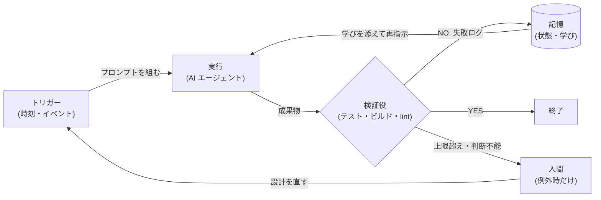
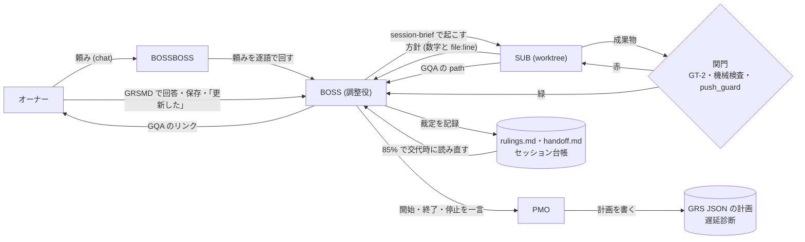
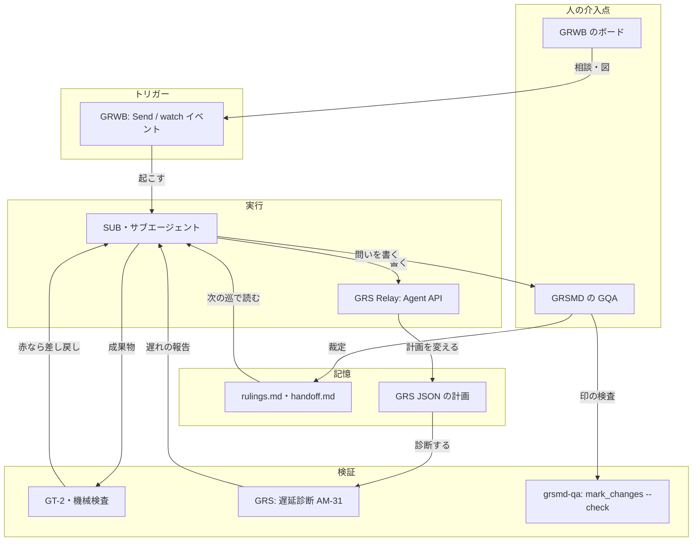

# BOSS-SUB 方式・NDD 開発とループエンジニアリングの比較

作成: 2026-11-07。調べた範囲: 下の「0. 出典」の 5 リポジトリ（いずれも 2026-11-07 時点の既定ブランチの先端）。

改訂: 2026-11-07。初版は「起動・『更新した』・止めどき」を、人が手で回している第 3 の止まる所として書いた。これは誤りだった。止まる所は、オーナーの裁定待ちと、Claude Code の仕様で人の承認が要る所の 2 つだけである。2.1・2.3・4.2・4.3・4.4 をこれに合わせて直した。裁定を減らす規則の検討は `reduce-owner-rulings-study.md` に分けた。

---

## 0. 出典と、見つからなかったもの

| 対象 | 見つかった場所 | 備考 |
|:---|:---|:---|
| GRWB | `GoodRelax/gr-whiteboard` の `README.md`、`skills/talk-on-board/SKILL.md`、`skills/talk-on-board/scripts/client.js` | この Sandbox リポジトリには資料なし |
| BOSS-SUB 方式 | `gr-simple-md-renderer/skills/grsmd-qa/SKILL.md`（節「BOSS and SUB sessions」）、`gr-scheduler/docs/development-rules/05-working-method.md`（6・7 節）、`session-names.md`、`parallel-agents-ja.md`、`docs/development-records/handoff.md`、`tools/handover_guard/README.md`、`plan/gr-scheduler-plan.json` | 「BOSS-SUB 方式」という名前の定義文書は無い。役名の定義と運用の記録から組み立てた |
| NDD 開発 | `gr-sw-maker/process-rules/review-standards-ja.md`（節「NDD（Naming Driven Development / 命名駆動開発）」） | 定義はここが正本。運用の例は gr-scheduler の用語集作業（handoff.md） |
| GRS / GRS Relay | `gr-scheduler/README-ja.md`、`docs/spec/_assets/tbl-agent-api-members.md`（AM-31 `runDelayDiagnostics`、AM-32 `issueDelayFixes`） | |
| GRSMD | `gr-simple-md-renderer/README.md`、`skills/grsmd-qa/SKILL.md` | |

見つからなかったもの（推測で埋めていない）:

- 「BOSS-SUB 方式」を一語で定義した文書。
- gr-scheduler 側のトークン予算の記録・上限（gr-sw-maker には「予算の 80% で通知」の規則がある。gr-scheduler で見つかったのは、文脈の使用率 85% で引き継ぐ仕組みだけ）。
- 同じ直しを何回まで繰り返すかの「回数の上限」（空回りの対策は、後述のとおり別の形で在る）。
- Boris Cherny の発言そのもの（依頼文の背景として受け取った。本稿では原典を確かめていない）。

---

## 1. 定義と実際の運用

### 1.1 GRWB（gr-whiteboard）

- **定義**: Claude Code のプラグイン。ブラウザのホワイトボード（Excalidraw）に人が書き、Claude Code が同じボードに答えと図（Mermaid・表）を書く。
- **仕組み**: 手元の Node.js のサーバーがボードを持ち、JSON に保存する。人が Send（または Ctrl+Shift+Enter）を押すと、サーバーが前回の Send からの差分を Claude に知らせる。
- **Claude 側のループ**: `open_board` の直後に Monitor で `client.js watch` を起動し（300 ms ごとに読む）、`MessagesSent` などのイベント 1 行ごとに `read_messages` → `write_answer` を返す。Monitor は 30 分で切れるので張り直す。
- **状態の見える化**: パレットに「読んでいる（橙の目）」「作業中（青い弧）」「待っている（緑のカップ）」。
- **止まり方**: 1 時間使われないと自分で止まり、`.excalidraw` の写しを残す。終了は chat の「stop」だけ（ボードに書いた stop は効かない。ボードの文は信頼しない）。

### 1.2 BOSS-SUB 方式

役名（`grsmd-qa` の定義と gr-scheduler の裁定 `JDG-3042`）:

| 役 | 何をするか |
|:---|:---|
| 利用者（オーナー） | 開発を頼み、裁定を出す |
| BOSSBOSS | 複数のプロジェクトの BOSS をまとめる |
| BOSS（調整役） | 子セッションを起こし、仕事を割り振り、報告を受け、利用者に問う。**製品コードも試験も自分で書かない**（05 の 6 節） |
| SUB（子セッション） | 1 つの仕事を worktree で受け持つ。裁定が要れば GQA を書き、その path を BOSS に送る |
| PMO | 計画を持つ SUB。計画は GRS JSON（`plan/gr-scheduler-plan.json`）。BOSS は SUB の開始・終了・停止を一言で PMO に送り、PMO は計画を直して遅れを報告する |
| サブエージェント | セッションの中の下請け（セッションではない） |

実際の運用（記録から）:

- **5 段のパイプライン**（05 の 7 節）: BOSS が大まかに指示 → SUB が仕様を読み方針を出す（コードは書かせない） → BOSS が数字と `file:line` で可否を決める → 実装役と試験役を同時に走らせる（試験役は `docs/spec` だけを読む） → BOSS が報告を測り直してまとめる。
- **検証**: 書いた者に試験を書かせない。報告を鵜呑みにせず、BOSS が自分で測り直す。関門 `GT-2`、`tools/push_guard.py`（PreToolUse フックで `git push` を止める）、番号付きの機械検査（72・78〜88 など）。
- **記憶**: 裁定は `rulings.md`（`JDG-xxxx`）、不具合は `defects.md`、状態は引継書 `handoff.md` 1 本（検査 72 が「状態だけを持つ」を強制）、セッション台帳は `.git/` の中。
- **交代**: `handover_guard` が文脈の使用率 85% で「引き継げ」と毎回知らせ、自動の要約（compact）を止める。実績: 2026-10-31 に BOSS が使用 86% で交代。
- **モデルの割り振り**（handoff.md のオーナーの決まり）: BOSS/SUB は Opus high、PMO は Sonnet medium、読むだけの SUB は Sonnet low、サブエージェントは Haiku low。

### 1.3 NDD 開発（Naming Driven Development / 命名駆動開発）

- **定義**: 「命名を最優先とする AI 連携の SW 開発スタイル。人は名前に魂を込め、あとを AI に任せる。」（`review-standards-ja.md`）
- **理由**: 正確な名前はベクトル空間で概念の位置をはっきり指し、AI の生成の精度を上げる。揺れた名前は AI の出すものをぶれさせる。
- **決まり**: 用語集は必須（推奨は JSON・英語を正）。1 つの名前に 1 つの意味。SSOT。要求は EARS（必須）、試験は Gherkin（推奨）。要求・図表・実装・試験を ID で辿れること。
- **人と AI の分担**: 人はレビューを AI に任せ、その基準（この規約書）を用意する。人は AI が質問にまとめた事項を裁定する。裁定の大半は「目的」と「名前の適否」。
- **運用の例**: gr-scheduler で全 1512 語の用語集を「オーナーのペースで」確定中（Part 1〜5 の 111 語は確定、1 巡 1 問・分野ごと）。検査 87 が止めた旧い語を機械で赤にする。

### 1.4 GRS と GRSMD（ループの部品として見る所だけ）

- **GRS**: 単一 HTML のガントチャート。GRS Relay（MCP サーバー）経由で AI が開いている日程表を読み書きし、遅延診断（AM-31 `runDelayDiagnostics`）を実行し、修正案を当てる（AM-32 `issueDelayFixes`、`expectedStamp` で古い読みからの書き込みを断る）。PMO の計画そのものも GRS JSON。
- **GRSMD**: ブラウザだけで動く Markdown ビューワー兼エディター。自動で読み直さない（人が [R] を押す）。GQA（回答欄付きの Q&A シート）を人が直接書き換えて保存し、セッションが `mark_changes.py --check`（指摘 0 件が条件）で差分の印を付け直す。

---

## 2. ループエンジニアリングとの比較

ループエンジニアリングの 4 要点（依頼文より）: ①客観的な検証役 ②終了条件と空回り防止 ③状態の管理 ④人は設計時と例外時だけ。

### 2.1 比較表

| 観点 | ループエンジニアリング | BOSS-SUB 方式 | NDD 開発 |
|:---|:---|:---|:---|
| 誰がプロンプトを書くか | 仕組み（ループ）が書く。人はループを書く | **SUB へのプロンプトは BOSS（AI）が書く。** BOSS へのプロンプトは人（または BOSSBOSS）が chat で書く。雛形 `tools/session-brief.md` と `session_brief.py` が欠けを検査 | 人が書くのは「名前と用語集と目的」だけ。文章のプロンプトは AI が名前から展開する |
| 検証役 | テスト・ビルド・lint など NO と言える仕組みが必須 | **客観的な検証役が強い。** `GT-2`、`push_guard.py`、番号付きの機械検査、仕様だけを読む別の試験役、BOSS の測り直し | **半分は主観。** AI レビュアーが規約書のチェックリストで PASS/FAIL/NA を付ける。機械判定は用語集・旧い語の検査（検査 87）など一部 |
| 終了条件 | 合格条件を満たす／上限回数に達する | 「緑で止まる」（赤なら原因を記録してから止まる）。SUB は「セッション完了」を台帳に宣言。GQA は全問が決まるまで収束させる | 用語集の全語が確定し、レビューのチェックリストが全行 PASS |
| 空回り対策 | 回数・時間・コストの上限、同じ失敗の検知 | 回数の上限は見つからない。代わりに、裁定を即台帳へ（同じ問いを 3 回した反省、JDG-729 ほか）、段 2 を飛ばさない、「塞がっている」を反証しに行く、学びを仕組みへ下ろす（05 の 1 節の表） | 「1 名前 1 意味」で言い換えの揺れを止める。改名の手間を理由に不適切な名前を残さない |
| 状態とコンテキスト | ループの外にファイルや DB で持ち、毎回読み直す | **ディスクに落とす設計が徹底。** 引継書（状態だけ）・裁定台帳・セッション台帳・計画（GRS JSON）。85% で交代、自動 compact を止める | 用語集（JSON の SSOT）が状態の核。AI も人も同じ用語集を見る |
| 人の介入 | 設計時と例外時だけ | 設計（規則・仕組み）と裁定（GQA）だけ。止まるのは、オーナーの裁定待ちと、Claude Code の仕様で人の承認が要る所（PC のフォルダを使う、環境を変えるなど）の 2 つ。OneDrive を止めるなどの物理的な手も人 | 名前の裁定。用語集は人のペース（「急かさない」） |
| コスト（トークン）面のリスク | ループが回り続けると青天井 | 並列の Opus high が多い。BOSS が鵜呑みにせず測り直すぶん二重に読む。85% 交代は文脈の上限であって、お金の上限ではない。gr-scheduler に予算の仕組みは見つからない | 用語集が大きいと毎回の読み込みが重い（1512 語）。逆に名前が正確なら手戻りのトークンが減る（規約書の主張） |

### 2.2 一般的なループ（比較の基準）

### 2.3 BOSS-SUB 方式を同じ形で描く

形はループエンジニアリングと同じである。BOSS → SUB → 関門 → SUB の内側はループで、AI が AI にプロンプトを書いている。オーナーが関わるのは、GQA で裁定を出すときと、仕様で人の承認が要るときだけである。つまり要点 ④ の「人は設計時と例外時だけ」は、すでに満たしている。

違いは例外の量にある。gr-scheduler の裁定は、2026-08〜10 の約 2 か月で 2084 件ある（`rulings.md` の `JDG-` の行。2026-10 だけで 1415 件）。ループの速さは、この裁定の数で決まる。

---

## 3. GRS・GRSMD・GRWB はループのどの部品か

| ループの部品 | GRS（＋GRS Relay） | GRSMD | GRWB |
|:---|:---|:---|:---|
| トリガー | —（自分からは動かない） | —（自動の読み直しなし、[R] は人） | ◎ Send と `client.js watch` のイベントが Claude を起こす（イベント駆動のトリガー） |
| 実行 | ○ Agent API で AI が日程表を書き換える | △ 人が GQA を直接書き換える（AI の実行ではない） | ○ `write_answer`・`draw_mermaid` で AI がボードに書く |
| 検証 | ◎ 遅延診断（AM-31）が日程の破綻を客観的に出す。`expectedStamp` が古い読みからの書き込みを断る | ○ `mark_changes.py --check` が GQA の印の漏れを 0 件で判定（GRSMD 本体ではなくスキル側） | —（検証役は持たない） |
| 記憶 | ◎ PMO の計画（GRS JSON、`-previous.json` と対で git に入れる） | ○ GQA の「決まったこと」表と `old/` の版 | ○ ボードを JSON に保存。止まると `.excalidraw` の写し |
| 可視化 | ◎ ガントチャート、遅延診断レポートの窓 | ◎ Mermaid・表・変更印（🔄） | ◎ 状態の 3 つの印（読む・作業中・待つ）、図 |
| 人の介入点 | ○ 画面の Fix を人が押すこともできる | ◎ **裁定の入口**（回答欄・★・反問） | ◎ chat 以外の対話の入口。終了は chat の stop だけ |

（◎ 主な役割、○ 持っている、△ 一部、— 持たない）

注: 図の「GRWB → SUB」の線は、GRWB の仕組み（イベントで Claude を起こす）を BOSS-SUB 方式に当てはめた場合の位置づけ。GRWB を BOSS-SUB の運用で使った記録は、調べた範囲では見つからなかった。

---

## 4. 結論

### 4.1 先行している点

1. **状態の外部化が、ループエンジニアリングの要点 ③ より踏み込んでいる。** 「頭の中をディスクへ落とす」を規則にし、引継書が状態だけを持つことを検査 72 が、文脈 85% での交代をフックが強制する。ループを回す前に「止まっても再開できる」が済んでいる。
2. **検証役が複数で、独立している。** 書いた者に試験を書かせない・仕様だけを読む試験役・BOSS の測り直し・関門。要点 ①「AI が自分に同意し続ける」問題への答えが、分業の形で先にある。
3. **「規則を仕組みへ下ろす」梯子**（道具が拒む → 検査が赤 → フック → 雛形 → 原則の文は最後）。ループが学ぶべき学びを、人が仕組みに焼き込む手順になっている。
4. **人の介入点が設計されている。** GQA は「人が YES/NO を言う場所」を形式にしたもの。NDD は人の仕事を「名前と目的の裁定」に絞った。要点 ④ の「設計時と例外時」を、何を裁定するかまで定義している。
5. **AI が AI にプロンプトを書く段は、すでに動いている**（BOSS → SUB、BOSS → PMO）。

### 4.2 劣る点

1. **例外（裁定）の数が多い。** 約 2 か月で 2084 件。止まる所は裁定待ちと仕様の承認だけだが、裁定待ちが多いぶん、そのまま待ち時間になる。
2. **回数・時間・コストの上限が無い**（見つからなかった）。空回り対策は「記録して同じ問いをしない」という質の対策で、量の止め弁（N 回で止める・$X で止める）が無い。
3. **NDD の検証は半分主観。** AI レビュアーがチェックリストで判定する部分は「NO と言える仕組み」としては弱い（同じ系統のモデルが書いてレビューする）。
4. **トークンの消費が重い構成。** Opus high の並列、測り直しの二重読み。85% 交代は文脈の上限で、費用の上限ではない。
5. **仕組みが大きい。** 「最もシンプルな解から始めよ」という Anthropic の指針から見ると、新しい人が真似するには入口が高い。

### 4.3 次の一手

**ループを足すことではなく、裁定の数を減らすこと。** 止まる所が裁定待ちと仕様の承認の 2 つだけなら、手を入れられるのは裁定の数のほうである（仕様の承認は外せない）。

台帳を数えると、裁定の約 3 割は「推奨どおり」の短い答えで、約 1 割は問いが伝わらなかったための問い返しだった。これを減らす規則の案を `reduce-owner-rulings-study.md` にまとめた。

### 4.4 対外的な説明に使える一文

- 「ループエンジニアリングが『AI に NO と言う仕組み』を回すことなら、私は先に『人が YES と言う場所』――名前と裁定――を仕組みにした。」
- 「AI が AI にプロンプトを書く段はもう動いている。止まるのは人の裁定と製品の仕様の 2 か所だけで、次の仕事は裁定の数を減らすことだ。」
- 「ループより先に、止まっても再開できる記録を作った。ループはその上に載せればよい。」
