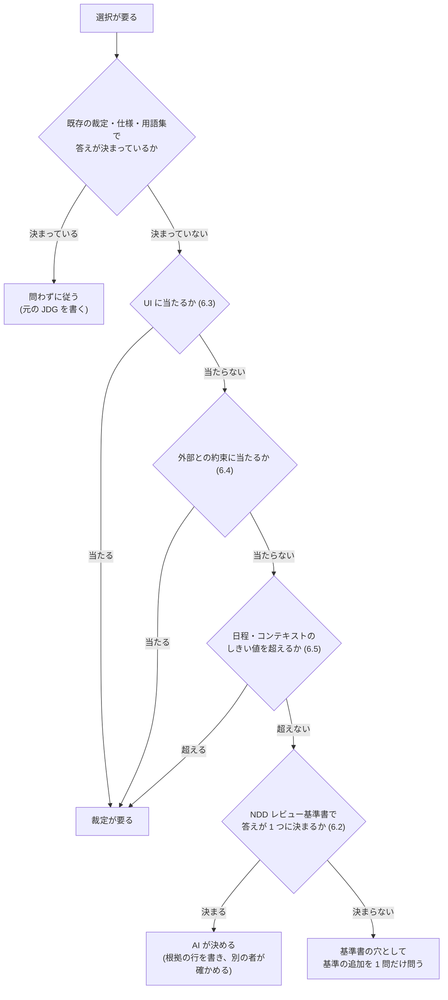

# オーナーの裁定を減らす規則の検討

作成: 2026-11-07。関連: `loop-engineering-vs-boss-sub-ndd.md` の 4.3。

改訂: 2026-11-07。オーナーの方針（5 章）を受け、その詳細（6 章）と、委任の安全策（7 章）を足した。初版の 5 章の問いは 8 章に置き換えた。

---

## 1. 前提

- 作業が止まるのは、(1) オーナーの裁定待ちと、(2) Claude Code の仕様で人の承認が要る所、の 2 つだけである（オーナーの認識。2026-11-07 に確認した）。
- (2) は製品の仕様なので外せない。手を入れられるのは (1) の数である。
- 減らしてよいのは、**オーナーが判断していない裁定**だけである。目的と名前の裁定（NDD で人に残す仕事）は減らさない。

---

## 2. 測った事実

### 2.1 何を数えたか

- 対象: `GoodRelax/gr-scheduler` の `docs/development-records/rulings.md`（2026-11-07 時点の既定ブランチの先端）。
- 頭のセルが `| JDG-n |` の行: **2084 行**。2026-09 が 640 行、2026-10 が 1415 行（行の中の最初の日付で数えた）。
- そのうち、オーナーの言葉が「**「…」**」の形で先頭にある行: 1993 行。下の分類はこの 1993 行を対象にした。
- GRSMD・GRWB などのチームの裁定台帳はオーナーの PC にあり、このセッションからは読めないので数えていない。

### 2.2 答えの中身の分類（キーワードで機械的に分けた概数）

| 分類 | 件数 | 割合 | 分け方 | 例（逐語） |
|:---|:---|:---|:---|:---|
| 1. 推奨・提示どおり（短い） | 653 | 33% | 「推奨」「Recommended」「提案通り」「それでよい」「そうしろ」、または選択肢の文字だけを含み、25 字以下 | 「いま始める (推奨)」「a」「それでよい」 |
| 2. 推奨どおり＋追加の指示 | 231 | 12% | 1 の語を含み、26 字以上 | 「推奨通りでよい。また、信用できない は 信用できない・要修正 とせよ。…」 |
| 3. 問い返し | 218 | 11% | 「？」を含み、1 の語も命令の語も含まない | 「えーと手動で上書き保存する場合か？Ctrl+Sとおなじか？ 良く分からんな。…」 |
| 4. 新しい指示・決まり | 450 | 23% | 「しろ」「せよ」「書け」「禁止」などを含む | 「否定形や受動態は原則禁止。 他動詞は目的語を書く。これはルールに入れろ！」 |
| 5. その他の自由文 | 441 | 22% | 上のどれにも当たらない | 「3 ブランチ。提案通りでよい。…」 |

確かめたこと:

- 選択肢を記録してある行（「示した案:」を持つ行）で、答えが文字だけの 27 件のうち、**25 件は推奨の選択肢を選んでいた**（93%）。
- 分類 1 から 10 件、分類 3 から 12 件を無作為に読み、分け方が中身と合っていることを目で確かめた。分類 3 の多くは、問いの意味が伝わらず、オーナーが聞き返したり、別の案を出したりしたものだった。
- キーワードで分けた概数である。1 件ずつ読んだ数ではない。

### 2.3 読み取れること

- 約 3 割（分類 1）は、オーナーが判断を加えずに推奨を通している。
- 約 1 割（分類 3）は、問いが伝わらなかったために 1 往復増えている。
- 約 2 割（分類 4）は、オーナーからの新しい指示である。これは減らす対象ではない。ただし、同じ種類の問いが二度と出ないように、一般の決まりへ下ろせるものが混じっている（例: 「これはルールに入れろ！」）。

---

## 3. すでにある規則

gr-scheduler には、裁定を減らす規則がすでにある。新しい規則は、これを広げる形で考える。

| 規則 | 場所 | 中身 |
|:---|:---|:---|
| 問う前に必ず引く | `docs/development-rules/06-pending-decisions.md` の 1 | `rulings.md` を grep し、仕様・`docs/reference/`・`studies/` を当たってから、初めて裁定待ちとする |
| 可逆コストで 8 つに分ける | 同 2 | A〜C（覆すのが安い）は問わずに推奨で進め、印を付けて後でまとめて問う。D〜H（覆すと高い）は待つ |
| 問う前に埋める欄 | `05-working-method.md` | 機構・実測・選択肢（帰結を数で）・推奨・覆す費用 |
| 常設の許し | `JDG-321` ② | 仕様の自己矛盾を直すだけなら、分類 G でも問わずに進めてよい |
| 一時の委任 | `JDG-120` | 「迷ったら推奨通りでよい。ただし、俺が帰宅したらその部分を報告すること。」 |

06 の実測には、「1 巡で 14 件の裁定を並べ、そのうち 8 件は A〜C であった」とある。規則はあるが、守られていない回がある。

---

## 4. 規則の案

### 案 R1. A〜C は問わずに決める（承認は事後に一覧で）

- **何を変えるか**: 06 では、A〜C も「まとめて問う」ことになっている。これを「AI が推奨で決め、決めた一覧を事後に見せる。オーナーは異議のある行だけに答える」に変える。
- **根拠**: 分類 1 が 33%。文字だけの答えは 93% が推奨どおりだった。
- **安全の仕組み**: A〜C は覆すのが安いことを、分類の定義が保証している。D〜H はこれまでどおり 1 件ずつ問う。
- **機械で守らせる**: 一覧に載った行が「異議なし」のまま一定期間たったら、`rulings.md` に「委任による決定」と書く。その行は、委任の元の JDG を引く。

### 案 R2. 既存の裁定・用語集から導ける問いは問わない

- **何を変えるか**: 「問う前に必ず引く」を、grep だけでなく導けるかどうかまで広げる。導けたら問わずに決め、導いた元の JDG と用語集の語を、決めた行に書く。
- **根拠**: 06 の実測（3 件のうち 2 件はすでに答えがあった）。NDD の用語集が JSON で機械に読めるなら、名前の候補の多くは用語集から導ける。
- **残すもの**: 用語集に無い新しい名前と、名前の適否そのものはオーナーに残す（NDD の人の仕事）。

### 案 R3. 指示を一般の決まりへ下ろす（同じ種類の問いを二度出さない）

- **何を変えるか**: GQA を閉じるとき、その巡の裁定を読み直す。ほかの場面にも当てはまる指示（分類 4 の一部）があれば、規則か検査へ下ろす案を、次の GQA に 1 問として出す。
- **根拠**: 05 の 1 節の「漏れると高くつく規則は、仕組みへ下ろす」の梯子がすでにある。それを裁定にも当てる。
- **例**: 「否定形や受動態は原則禁止。…これはルールに入れろ！」（JDG-3483）は、文章の検査に下ろせば、文の書き方の問いが以後出なくなる。

### 案 R4. 問いを出す前に、別の者に冷たく読ませる

- **何を変えるか**: GQA を渡す前に、文脈を持たないサブエージェント（Sonnet low など）に GQA だけを読ませ、「各問いで、どの選択肢が何を変えるか」を答えさせる。答えられない問いは書き直す。
- **根拠**: 分類 3（問い返し）が 11%。問い返し 1 件が 1 往復になる。
- **費用**: 読み手 1 回分のトークン。1 往復ぶんのオーナーの時間と比べれば小さい。

### 案 R5. 委任の範囲を広げる代わりに、覆った率を測る

- **何を変えるか**: R1・R2 で AI が決めた行のうち、後でオーナーが覆した数を数える。覆った率が決めた線（例: 10%）を超えた分類は、委任から外す。
- **根拠**: 委任を広げる安全の仕組みが要る。06 の 4 にも「推奨がそのまま通るとは限らない」とある。
- **機械で守らせる**: `tools/ledger_metrics.py` のような数え手に、委任の決定と、それを覆した裁定の対を数えさせる。

### 4.1 効く量の見込み

| 案 | 減らす対象 | 見込み |
|:---|:---|:---|
| R1 | 分類 1 のうち A〜C の分 | 分類 1 のうち A〜C が何割かは、今は測れない（問いに A〜H を付けていない行が多い）。上限は全体の 33% |
| R2 | 分類 1 のうち既存の裁定で導ける分 | 同上。R1 と重なる |
| R3 | 将来の同じ種類の問い | 次の巡から効く。今の数からは見込めない |
| R4 | 分類 3 | 上限は全体の 11% |
| R5 | （減らす案ではなく、R1・R2 の安全の仕組み） | — |

数の見込みを確かにするには、これから出す問いすべてに A〜H の分類を付け、2 週間分を数えるのがよい。

---

## 5. オーナーの方針（2026-11-07、逐語）

> 「NDDレビュー基準書に従いSW工学的に正しい選択を行うケースは俺の裁定は不用。
> UIは俺の裁定が必須
> 外部とのAPIや命名、ファイル形式など外部との約束は俺の裁定が必須
> 日程が大幅に遅れる、コンテキストの使用量が多い、週間コンテキストの上限が近い場合は裁定が必須。」

この方針は、4 章の R1・R2 の範囲を決める。R1・R2 は「この方針で裁定が要らないもの」にだけ当てる。

---

## 6. 方針の詳細

### 6.1 判定の順番

1 つの選択が複数の種類に当たることがある（例: 内部の作り直しで、SW 工学的には正しいが、日程が大幅に遅れる）。**裁定が要る種類に 1 つでも当たれば、裁定が要る。** 判定は次の順に行う。

### 6.2 裁定が要らないもの: NDD レビュー基準書で答えが決まる選択

- **対象の基準書**: `gr-sw-maker/process-rules/review-standards-ja.md`（NDD 節、R1〜R8、総合レビューチェックリスト、設計原則の索引）。
- **「答えが決まる」とは**: 選択肢のうち、総合レビューチェックリストの MUST をすべて PASS するものが 1 つだけある場合。または、複数が PASS し、そのうち 1 つだけが SHOULD や設計原則（SRP、SSOT など）にも合う場合。
- **例**: 関数の分け方、内部の層の切り方、内部の変数名・関数名（NEIM に従う）、試験の書き方（Gherkin）、重複の消し方（SSOT）、マジックナンバーの名前付け。
- **AI がすること**:
  1. 決めた行に、根拠にした基準書の行（観点の名前と、MUST か SHOULD か）を書く。
  2. 決めた者とは別のサブエージェントに、その行が本当に 6.3〜6.5 に当たらないかを確かめさせる（7 章の T2）。
- **基準書で決まらないとき**: 選択肢が 2 つ以上 PASS し、基準書がどちらとも言わない場合である。これは基準書の穴なので、「この種類の選択はこう決める」という**基準の追加**を 1 問だけ問う。個々の選択を問うのではない。一度決めれば、同じ種類の問いは以後出ない。
- **注意: 命名の扱いが変わる**: 基準書の NDD 節には「裁定の大半は、目的と、名前の適否」とある。この方針では、**内部の名前**は基準書（NEIM と用語集）で決め、裁定が要るのは**外部に見える名前**（6.4）だけになる。用語集の語は画面や文書に出るので 6.4 に当たる（8 章の問 3 で確かめる）。

### 6.3 裁定が要るもの: UI

**利用者の目に見える、または手で触れるもの**はすべて UI とする。

| 当たるもの | 例 |
|:---|:---|
| 画面に出るものの配置・大きさ・色・線幅・余白 | パネルの幅、線の太さ、ボタンの位置 |
| 画面に出る言葉 | ボタンの名前、メッセージ、ツールチップ、ヘルプの文 |
| 操作 | キー、クリック、ドラッグ、ショートカット、待ち時間 |
| 画面に出る初期値 | 新しい文書の既定の設定 |
| 出力の見た目 | 印刷、画像の書き出し、Mermaid の描き方 |

- **規則 06 との食い違い**: 06 の A（線幅・色・待ち時間・寸法）と C（表示だけの選択）は、今は推奨で進めてよい種類である。方針では UI は裁定が必須なので、**A と C のうち UI に当たるものは、裁定が要る側へ移す**。
- **進め方**: 裁定は要るが、待つかどうかは別である。UI の推奨値で作り、触れる見本をあなたに見せ、裁定で確定する進め方もできる（gr-scheduler の 05 の「UI の数は触れる見本で決める」）。どちらにするかは 8 章の問 2 で決める。

### 6.4 裁定が要るもの: 外部との約束

**このソフトの外にいる相手（人・他のソフト・AI）が当てにするもの**とする。

| 当たるもの | 例 |
|:---|:---|
| 保存・交換するファイルの形式 | GRS JSON のスキーマとキー名、MSPDI の往復、拡張子、ファイル名の決まり |
| 公開する API | Agent API のメンバ（表 T-064）、継ぎ目（表 T-065）、MCP のツール名と引数 |
| 外に見える名前 | 製品名、コマンド名、スキルの名前、プラグインの名前、用語集の語 |
| 外の相手に見える振る舞い | 受け入れる入力と拒む入力の境目（06 の F） |

- **規則 06 との関係**: 06 の D（保存・交換される値）、E（公開署名・継ぎ目）、F（受け入れの境目）にほぼ重なる。06 はこれらをすでに「待つ」としているので、方針と食い違わない。

### 6.5 裁定が要るもの: 日程とコンテキスト

「大幅」「多い」「近い」には数が要る。下の値は案であり、8 章の問 4 で決める。

| 条件 | しきい値の案 | 測り方 |
|:---|:---|:---|
| 日程が大幅に遅れる | 次のマイルストーンの見込みが **1 日以上**遅れる、またはクリティカルパスの残りが **20% 以上**延びる | PMO が GRS の遅延診断（AM-31 `runDelayDiagnostics`）と計画の GRS JSON で出す |
| コンテキストの使用量が多い | 1 つの仕事が、**1 本のセッションで終わらない**と見込まれる（途中で 85% の交代が要る） | 仕事を始める前に、BOSS が見積もる。始めた後は `handover_guard` の 85% の知らせ |
| 週間の上限が近い | 週間の使用量の残りが **20% を切る** | このセッションでは測り方を確かめていない。候補は、Claude のアプリの使用量の表示、Claude Code の `/usage`、セッションの記録に残る使用制限のイベント |

- **裁定で問うこと**: 個々の選択ではなく、「何を先にし、何を後に回すか」「どのモデルで回すか」を問う。
- **遅れや使用量を理由に、6.2 の正しい選択を手抜きに変えない**。手抜きは負債になる（7 章）。手抜きが要るなら、それも裁定で問う。

### 6.6 方針で裁定が減る量の見込み

4 章の分類 1（推奨どおりの短い答え、653 件）の中身を、裁定の行の文脈の語で分けた（キーワードによる概数）。

| 文脈の語 | 件数 | 方針での扱い |
|:---|:---|:---|
| UI の語だけ（画面・表示・窓・ボタン・色・配置など） | 231 | 裁定が要る（6.3） |
| 外部の約束の語だけ（GRS JSON・MSPDI・スキーマ・キー名・API・MCP など） | 45 | 裁定が要る（6.4） |
| 両方 | 20 | 裁定が要る |
| どちらでもない | 357 | 6.2 で決まるなら、裁定が要らない |

- 減らせる上限は、分類 1 の 357 件で、**全体の約 18%**（357 / 1993）である。初版の見込み（上限 33%）より小さい。UI の裁定を残すためである。
- 6.2 の「基準の追加」で、同じ種類の問いが以後出なくなる分は、この数に入っていない。

---

## 7. 委任の安全策（意図しない技術的負債を防ぐ）

AI が決める範囲を広げるほど、オーナーが見ない所で決まることが増える。そのため、**負債を数にし、その数がオーナーの了承なしには増えないようにする**。

### 7.1 すでにある防ぎ（gr-scheduler）

| 負債の入り方 | 防いでいる仕組み |
|:---|:---|
| 推奨で進めた暫定が忘れられる | `@provisional` の印と裁定待ちの一覧を、検査 25 が双方向に突き合わせる。裁定が済んだのに残った印も赤にする |
| 暫定の上に暫定を積む | 06 の分類 H として例外なく禁止 |
| 覆すと高いものを AI が勝手に決める | D〜H は推奨で実装できない。印があれば検査 25 が落とす |
| 赤を黙らせるために基準を緩める | 基準線を「借金」として扱う。上げるには毎回オーナーの了承が要る（JDG-161）。下げるのは調整役が問わずにできる（JDG-520） |
| 関数の肥大・マジックナンバー | 関数の大きさの基準線（検査 60）、`magic-numbers.md` |
| SRP の違反が増える | 新しく書く・改訂する所には直ちに当てる（05 の表） |

### 7.2 残っている穴

1. **分類の誤り**: 06 の 6 節のとおり、分類の正しさは機械では見られない。6.3〜6.5 に当たるものを 6.2 と誤れば、裁定の要る決定が黙って入る。
2. **検査の無い種類の負債**: 数える仕組みの無い負債は、増えても赤にならない。
3. **全体が見えない**: 基準線・暫定の数・既知の赤・マジックナンバーが別々のファイルにあり、増減を 1 か所で見られない。

### 7.3 足す案

| 案 | 中身 | 塞ぐ穴 |
|:---|:---|:---|
| T1. 負債の週報 | 基準線、`@provisional` の数、`tests/known-red.txt` の行数、関数の大きさの超過、マジックナンバーを 1 表に並べ、先週との差を出す。オーナーは増えた行だけ見る。PMO の仕事に足す | 3 |
| T2. 分類を別の者が確かめる | AI が決めた行（6.2）を、決めた者とは別のサブエージェントが読み直し、6.3〜6.5 に当たらないかを見る。疑いがあれば裁定へ戻す | 1 |
| T3. 覆った率で委任を縮める | 4 章の R5。AI が決めたものをオーナーが後で覆した率を種類ごとに数え、線を超えた種類は委任から外す | 1 |
| T4. 負債の定義表 | 何を負債とみなすかを表にし、オーナーの裁定を 1 回取る。表に無い種類の負債に気づいたら、検査に下ろす案を GQA の 1 問として出す（オーナーの「ゴキブリ理論」の指摘を検査に変える経路） | 2 |
| T5. 独立レビューを定期に回す | 今は節目ごと（例: 0.8.0 の設計の独立レビュー）。これを定期にし、NDD 基準書と R1〜R8 で見る。検査の無い負債はここでしか見つからない | 2 |

**限界**: 意図しない負債をゼロにはできない。狙うのは、(1) 見える負債はオーナーの了承なしに増えない（T1 と既存の基準線の規則）、(2) 見えない負債は見える負債に変える経路を持つ（T4・T5）、の 2 つである。

---

## 8. オーナーに決めてほしいこと

### 問 1. どこから入れるか

| 選択肢 | 中身 |
|:---|:---|
| **a（推奨）** | **5 章の方針と 6.1 の判定の順番、7 章の T1・T2・T3 を一緒に入れる。** 委任を広げるのと同時に安全策を入れる。T4・T5 は次の段で入れる |
| b | 方針と 7 章の T1〜T5 を全部一緒に入れる |
| c | 方針だけ先に入れ、安全策は 2 週間後に覆った率を見てから決める |

回答:

### 問 2. UI の裁定の進め方

| 選択肢 | 中身 |
|:---|:---|
| **a（推奨）** | **推奨値で作り、触れる見本を見せ、裁定で確定する。** 作業は止めない。裁定で覆ったら直す（UI は内部に閉じていれば覆すのが安い） |
| b | 裁定が出るまで、その UI は作らない |

回答:

### 問 3. 用語集の語は「外部との約束」か

| 選択肢 | 中身 |
|:---|:---|
| **a（推奨）** | **外部との約束とする（裁定が要る）。** 用語集の語は画面・文書・GRS JSON のキーに出る |
| b | 画面や外部の形式に出る語だけを外部との約束とし、内部だけで使う語は 6.2 で決める |

回答:

### 問 4. 日程とコンテキストのしきい値

| 選択肢 | 中身 |
|:---|:---|
| **a（推奨）** | **6.5 の表の案のとおり**（マイルストーン 1 日以上の遅れ、またはクリティカルパスの残りが 20% 以上延びる／1 本のセッションで終わらない仕事／週間の残り 20% 未満） |
| b | 値を直す（回答欄に値を書く） |

回答:

### 問 5. どのプロジェクトに当てるか

| 選択肢 | 中身 |
|:---|:---|
| **a（推奨）** | **gr-scheduler で 2 週間試し、覆った率（T3）を見てから、ほかのチームへ広げる** |
| b | 全チームに一度に当てる |

回答:
